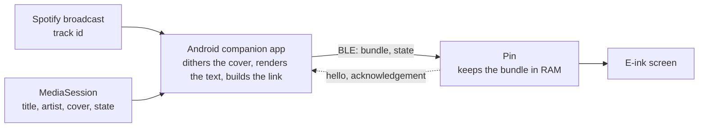

# Now Playing Pin

A wearable e-ink pin that shows what is playing on your Android phone: cover art, title and
artist. One button switches to a QR code so the person next to you can open the track.

The pin is held on clothing by a magnetic badge clip and is meant to run for months on a
small LiPo cell.

> **Status: design phase.** No hardware has been ordered or measured, and this repository
> contains documentation and build scaffolding only. Values tagged **[to verify]** come from public pages and have
> not been confirmed on a real part. Battery life figures are estimates, never measured.

## How it works



On every track change the phone sends one complete bundle: dithered cover, pre-rendered text
and share link. The pin keeps the bundle in RAM, so switching views never wakes the phone.

## Design choices

- **Android only.** No iOS.
- **BLE only.** The pin is a GATT peripheral, the phone is the central. No Wi-Fi and no
  Bluetooth Classic on the pin.
- **The phone does all the work**: metadata, image processing, text rendering. The pin is a
  display.
- **No network required.** The share view is a QR code generated on the pin.
- **Event driven everywhere.** No polling.
- **Battery life comes before features.** No progress bar, no periodic refresh.
- **nRF52840 rather than ESP32-S3**, for BLE power consumption and for NFC in a later version.

Each choice is recorded with its reasons in [docs/adr/](docs/adr/README.md).

## Hardware

| Part | Choice |
| --- | --- |
| Board | Seeed XIAO ePaper Display Board EN05 (XIAO nRF52840 Plus) |
| Screen | 2.13" black and white e-paper, 122 × 250 px, partial refresh |
| Battery | 3.7 V protected LiPo, around 250 mAh (not chosen yet) |
| Mount | Magnetic badge clip, 3 neodymium magnets |

Details and the list of things to confirm are in [docs/hardware.md](docs/hardware.md).

## Repository layout

The directories marked "planned" are created when their first real file lands.

```text
docs/         design documents
tools/        scripts (documentation checks today; test vectors later)
android/      companion app (Kotlin, Gradle), an empty screen today
firmware/     host build (CMake) of the portable C++
  pin/        Arduino sketch for the board (empty today)
  render/     portable C++ (framebuffer, layout, QR code)
  sim/        PC executable that renders test packets to images
  tests/      unit tests of the portable C++ (doctest)
enclosure/    parametric CAD                                         planned
```

## Documentation

| Document | Content |
| --- | --- |
| [docs/roadmap.md](docs/roadmap.md) | What V1 is, milestones, order of work, risks |
| [docs/architecture.md](docs/architecture.md) | System overview, responsibilities, data flow per track |
| [docs/hardware.md](docs/hardware.md) | Parts, what is known about them and from where, checks to run |
| [docs/protocol.md](docs/protocol.md) | BLE protocol draft: security, connection sequence, messages |
| [docs/android-app.md](docs/android-app.md) | Companion app: data sources, pipeline, permissions, privacy |
| [docs/firmware.md](docs/firmware.md) | Views, buttons, states, refresh policy, rendering library |
| [docs/display-spec.md](docs/display-spec.md) | What is drawn where: zones, text rules, badges, QR code, built-in screens |
| [docs/power.md](docs/power.md) | Power estimate and measurement plan |
| [docs/enclosure.md](docs/enclosure.md) | 3D printed case requirements |
| [docs/safety.md](docs/safety.md) | Battery, magnets, and wearing the pin |
| [docs/testing.md](docs/testing.md) | Test strategy: levels, golden images, shared vectors, checklists, CI |
| [docs/adr/](docs/adr/README.md) | Architecture decision records: why each choice was made |
| [docs/spikes/](docs/spikes/README.md) | Experiments planned to settle the open questions |
| [CHANGELOG.md](CHANGELOG.md) | What changed, newest first |
| [CLAUDE.md](CLAUDE.md) | Guide for AI agents working in this repository |

## Where it stands

The first version (V1) is the cover view, the QR share view and a measured battery life. The
milestones, in order: a simulated pin on the PC, the real pin on the desk, the wearable V1.
The detail is in [docs/roadmap.md](docs/roadmap.md).

## About this project

This is a personal project that I build alone, in my spare time. There is no release
schedule and no support. The documentation is written first for my own use, and published in
case it helps someone building something similar.

Issues are welcome if you spot a mistake or have a question. See
[CONTRIBUTING.md](CONTRIBUTING.md) before opening a pull request.

## Disclaimer

This is a home-made device with a lithium cell and magnets. Read
[docs/safety.md](docs/safety.md) before building or wearing one.

This project is not affiliated with or endorsed by Spotify. Spotify and Spotify Codes are
trademarks of Spotify AB. The repository contains no Spotify logo, code image or cover art.

## License

[MIT](LICENSE)
