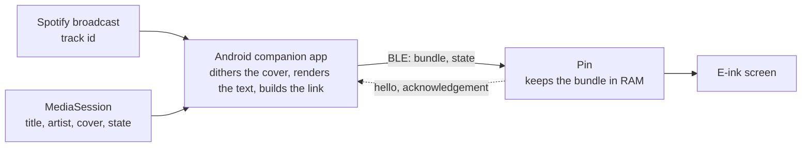

# Architecture

Status: design, nothing implemented.

## Overview

Two parts:

- **Companion app (Android, Kotlin).** Watches what is playing, prepares everything the pin
  needs to display, and pushes it over BLE. See [android-app.md](android-app.md).
- **Pin (nRF52840 + 2.13" e-paper).** Receives a bundle, keeps it in RAM, draws it, and goes
  back to sleep. See [firmware.md](firmware.md).

## Decisions

The decisions that shape this design, with their context and consequences, are in
[adr/](adr/README.md). This document does not repeat them.

## Split of responsibilities

| Task | Phone | Pin |
| --- | --- | --- |
| Detect track and playback changes | yes | |
| Fetch and dither the cover | yes | |
| Render title and artist to a bitmap | yes | |
| Build the share link | yes | |
| Decide whether anything needs to be sent | yes | |
| Draw the QR code from the link | | yes |
| Compose the views and icons, refresh the screen | | yes |
| Hold the pairing screen and the sleep image | | yes |

Rendering the text on the phone means every script and every emoji works without storing a
font on the pin.

## What happens on a track change

1. The app receives a metadata event and waits about 500 ms, because the cover sometimes
   arrives after the title.
2. It merges its two sources (MediaSession and the Spotify broadcast) and builds the bundle:
   cover bitmap, text bitmap, share link.
3. If the bundle differs from the last one sent, it sends **everything at once** over BLE.
4. The pin checks the transfer, acknowledges it, and refreshes the screen **once**.
5. The pin keeps the bundle in RAM. Switching between the cover view and the share view is
   local and never contacts the phone.

A change of playback state alone (pause, resume) sends a short state message, not a bundle.

The wire format, the connection sequence and what happens on reconnection are described in
[protocol.md](protocol.md). The pin's states and what triggers a refresh are described in
[firmware.md](firmware.md).

## What V1 leaves out

The Spotify Code, media control from the pin's buttons and the settings are designed for
but not built in V1 ([ADR-0010](adr/0010-v1-scope.md), [roadmap.md](roadmap.md)).
