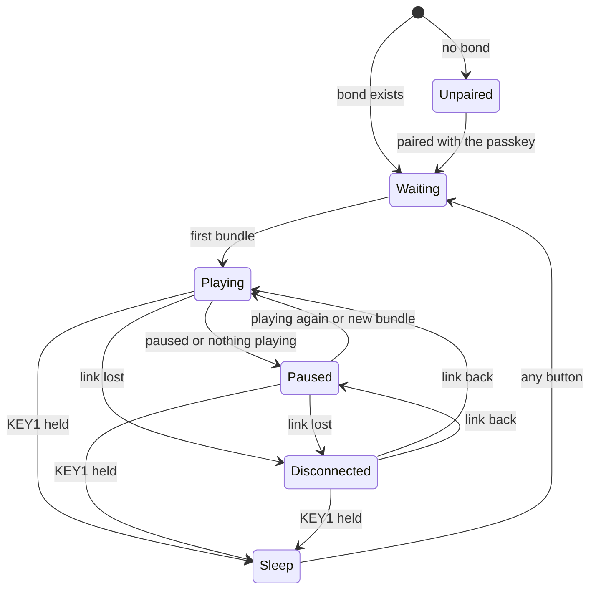

# Firmware

Status: design, nothing implemented. Arduino, Seeed nRF52 core with Bluefruit
([ADR-0014](adr/0014-arduino-seeed-nrf52-core.md)).

The screen is used in **landscape, 250 × 122**. This document describes V1
([ADR-0010](adr/0010-v1-scope.md)).

## Views

### Cover view (default)

```text
+--------------+---------------+
|    cover     |     text      |
|  122 x 122   |   128 x 122   |
+--------------+---------------+
```

Both bitmaps come from the phone. The renderer places them in its framebuffer without
processing them, then draws the state badges over the bottom left corner of the cover.

The exact zones, the badges and every size are in [display-spec.md](display-spec.md).

### Share view

The QR code replaces the cover on the left, the text stays on the right.

- Version 4 (33 modules), 3 px per module, so 99 px in the 122 px square.
- Library: `QRCode` (ricmoo).
- If no link was received, there is no share view and KEY1 does nothing.

The QR settings are checked in [spike 0005](spikes/0005-qr-size-and-scannability.md).

The Spotify Code view is planned for later
([ADR-0007](adr/0007-qr-share-view-spotify-code-later.md)).

### Built-in screens

Three screens are bitmaps stored in the firmware, because the pin has no font at run time:

- the **unpaired screen**, shown while the pin has no bond: it says how to open the pairing
  window;
- the **pairing screen**, shown while the pairing window is open;
- the **sleep image**, shown before System OFF. A custom image sent by the phone is planned
  for later.

## Buttons

V1 uses KEY1 for the views and sleep. KEY2 and KEY3 only carry the pairing gestures proposed
in [ADR-0012](adr/0012-ble-security.md).

| Button | Short press | Long press |
| --- | --- | --- |
| KEY1 | Toggle cover / share view | About 3 s: sleep image, then System OFF |
| KEY2 | Nothing in V1 (later: play / pause) | About 5 s, only with no bond: open the pairing window (proposed) |
| KEY3 | Nothing in V1 (later: next track) | With KEY2, about 10 s, only with a bond: erase the bond (proposed) |

- The two pairing gestures each exist in one state only, so holding both buttons to erase a
  bond cannot open the pairing window on the way.
- The pairing window closes after 60 s, at the first successful pairing, or after 3 failed
  attempts.
- Any button wakes the pin from System OFF. The board's power switch cuts the battery.
- The pin waits for KEY1 to be released before it enters System OFF. Otherwise the button
  still held would wake it at once.
- A wake from System OFF is a restart with a button held. The bootloader may read one of
  these buttons at start-up to enter an update mode **[to verify]**
  ([spike 0012](spikes/0012-pairing-and-reconnection.md)).
- On the board, KEY1 and the reset button are on one long edge, KEY2, KEY3 and the power
  switch on the other **[to verify]** ([hardware.md](hardware.md)). The gestures above are
  checked against the real buttons before they are fixed.

## States

| State | Screen | Radio |
| --- | --- | --- |
| Unpaired | Unpaired screen; pairing screen with the passkey while the pairing window is open | Advertising, with the pin's name, only while the pairing window is open |
| Waiting | Sleep image or last track, until the first bundle arrives | Advertising, then connected |
| Playing | Current track | Connected |
| Paused | Current track with the paused badge. "Nothing playing" is shown the same way | Connected |
| Disconnected | Last track with the disconnected badge | Slow advertising (1 to 2 s), with no name |
| Sleep | Sleep image | System OFF |



Erasing the bond leads back to Unpaired from any state.

While a bundle is being received, the screen does not change: the previous track stays until
the new bundle is complete.

## Refresh policy

The screen is refreshed on events only, never on a timer
([ADR-0006](adr/0006-one-bundle-per-track-refresh-on-events.md)).

| Event | Refresh |
| --- | --- |
| A bundle is complete and checked | One, for the new track |
| Playback state changes, same track | One, to add or remove the icon, once the state has been stable for a few seconds |
| Link lost | One, to add the icon, once the link has been lost for about 30 s |
| Link restored | If the disconnected badge is on screen and no bundle arrives within about 10 s of the hello: one, to remove it. Otherwise the bundle's own refresh removes it |
| Battery goes under 20 % | None by itself: the icon appears with the next refresh |
| KEY1 short press | One, for the other view |
| KEY1 long press | One, for the sleep image |
| Pairing window | One when it opens, one for each pairing attempt to show its passkey (3 at most), one when it closes |

The delays are starting values to tune. They exist so that a burst of play/pause or a short
loss of link does not cost a refresh each time.

- Partial refresh by default, full refresh about every 10 updates.
- Whether partial refresh is good enough on a dithered cover is not known
  ([spike 0010](spikes/0010-partial-refresh-ghosting.md)). The fallback is a full refresh
  for every track.
- After each refresh, the display and the XIAO's QSPI flash go to deep sleep
  ([power.md](power.md)).
- The bundle is never written to flash: it changes with every track and would wear it out.

## Display driver

- Library named by the Seeed wiki for the EN05: Seeed_GFX2.
- Panel controller: SSD1680.
- The configuration value for this board and this panel is not known. A value (508) was seen
  in the older Seeed_GFX library **[to verify]**, and a forum thread reports a build failure
  for that combination on the EN05.
- The wiki examples only show full refresh.

[Spike 0009](spikes/0009-display-driver.md) checks all of this on the real board. If the
library does not work, the fallback is a small SSD1680 driver.

The panel's own memory is in portrait, 122 columns stored in 128. The sketch converts the
landscape framebuffer to that layout. The bit order of the protocol and of the framebuffer
is chosen to keep this conversion cheap. A 180° rotation is a build-time constant, because
the side on which the panel is mounted in the case is not known yet.

## Firmware update

Through USB only. The sketch never starts the library's over-the-air update service, which
has no protection ([ADR-0012](adr/0012-ble-security.md)). The pin exposes the two generic
BLE services, the custom service and the battery level, and nothing else.

## Security

The rules are in [protocol.md](protocol.md) and [ADR-0012](adr/0012-ble-security.md). For the
firmware they mean:

- the custom service and the battery level are set to the highest security level;
- a random passkey is generated and displayed for each pairing attempt;
- a bond that appears outside the pairing window, or from a weaker pairing, is deleted and
  the link dropped;
- once bonded, a connection that does not become encrypted with the stored bond is dropped
  after about 5 s.

Part of this goes below the Bluefruit library, to the Nordic stack.

## Operating conditions

The panel is specified for 0 to 50 °C ([hardware.md](hardware.md)). Outdoors in winter is
outside that range: refresh may be slow or incomplete. This is accepted for V1 and noted in
[safety.md](safety.md).

## Rendering library

The rendering code (layout, QR code, icons) is **portable C++ with no Arduino dependency**
([ADR-0008](adr/0008-portable-renderer-and-simulator.md)). It draws into a 1-bit framebuffer.

- `firmware/render/`: the library.
- `firmware/sim/`: a PC executable that takes test packets and writes PNG or PBM images.

The views can therefore be designed and tested before any hardware exists, and the Arduino
sketch only has to push the framebuffer to the panel. How this code is tested is described
in [testing.md](testing.md).
