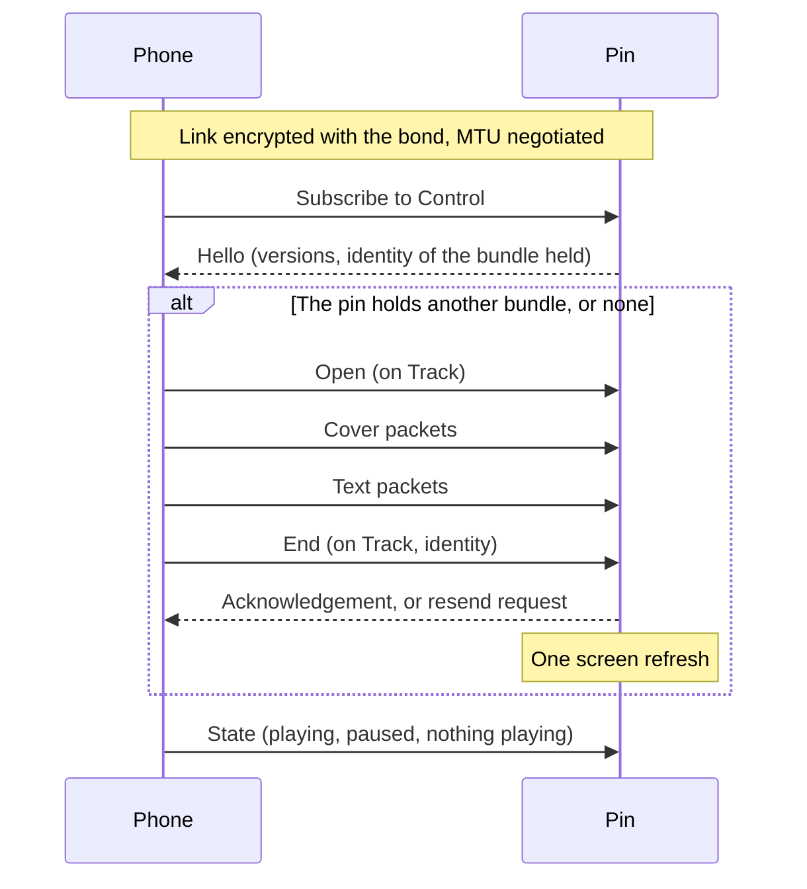

# BLE protocol (draft v0)

Status: **draft, not frozen.** The C++ side encodes and decodes every message
(`firmware/protocol/`); the Kotlin side does not exist yet. Every message has its byte layout
below. The protocol is frozen in M2, once the spikes listed at the end have answered its
open questions. The timeouts are starting values.

This document covers V1 ([ADR-0010](adr/0010-v1-scope.md)). What is planned for later is
listed so that the format leaves room for it.

## Roles

- Pin: GATT peripheral (server).
- Phone: central (client).

## Version

The protocol carries a version number, one byte. This draft is version 0, and the first
frozen version is 1. Every write from the phone starts with the version it uses, and the pin
announces the version it speaks in its hello (see "Connection lifecycle"). A pin that
receives a version it does not know refuses the message on Control, and a phone that
receives a hello with a version it does not know goes no further and says so in the app. The app and the
firmware are released by the same person, so V1 supports exactly one version at a time.

The first two bytes of the hello, its type and the version, keep their meaning in every
version, so that the phone can always tell which version the pin speaks.

## Security

Proposed in [ADR-0012](adr/0012-ble-security.md), not accepted yet.

- Pairing uses LE Secure Connections with a passkey: the pin shows a random 6-digit passkey
  on its screen and the user types it on the phone.
- Every characteristic of the custom service, and the battery level, require security mode 1
  level 4: a link encrypted from an authenticated pairing. A device paired any other way can
  connect but cannot read, write or subscribe.
- The passkey is only shown, and a new bond only kept, during a pairing window opened by a
  button gesture, and only when the pin has no bond. The window lasts 60 s.
- The pin keeps one bond. Once bonded, it drops any connection that is not encrypted with
  that bond within about 5 s.
- A second button gesture erases the bond.
- The pin's name and service UUID are advertised only during the pairing window.
- No firmware update over the air. The pin exposes no update service.

Open, for [spike 0012](spikes/0012-pairing-and-reconnection.md): whether the Bluetooth
library behaves as the ADR assumes, and whether the pin can use a private address without
breaking automatic reconnection.

## Services

| Service or characteristic | UUID |
| --- | --- |
| Custom service | `47d8b6b7-0001-4cdc-be21-882f01c7ecee` |
| Track | `47d8b6b7-0002-4cdc-be21-882f01c7ecee` |
| Cover | `47d8b6b7-0003-4cdc-be21-882f01c7ecee` |
| Text | `47d8b6b7-0004-4cdc-be21-882f01c7ecee` |
| State | `47d8b6b7-0005-4cdc-be21-882f01c7ecee` |
| Control | `47d8b6b7-0006-4cdc-be21-882f01c7ecee` |
| SpotifyCode (later) | `47d8b6b7-0007-4cdc-be21-882f01c7ecee`, reserved |

The UUIDs share one base, drawn by a random (version 4) UUID generator. Only the second
group changes, so a new characteristic takes the next number.

- The battery level, as the standard characteristic (0x2A19) of the standard Battery Service
  (0x180F), but protected at level 4 like the rest. The library's ready-made battery service
  is not used, because it is readable without encryption **[to verify]**.
- Nothing else beyond the two generic services every BLE device has. The device name cannot
  be written over the air.

## Characteristics of the custom service

| Characteristic | Direction | Property | In V1 | Content |
| --- | --- | --- | --- | --- |
| Track | phone → pin | Write | yes | Two messages: Open, which opens a bundle (version, track counter, playback state, size of each image, share link), and End, which closes it |
| Cover | phone → pin | Write Without Response | yes | Image packets of the cover. In V1: 122 × 122, so 1,952 bytes |
| Text | phone → pin | Write Without Response | yes | Image packets of the text. In V1: 128 × 122, so 1,952 bytes |
| State | phone → pin | Write | yes | Playback state alone, when it changes without a track change |
| Control | pin → phone | Notify | yes | Hello, acknowledgement, resend request, refusal |
| SpotifyCode | phone → pin | Write | later | 20 levels × 3 bits, packed in 8 bytes |

State is a characteristic of its own rather than a message on Track: a change of playback is
one short write that never touches a bundle in progress.

Each image announces its width and height in Open. The split between cover and text
(122 and 128 px) is a choice of the layout ([display-spec.md](display-spec.md)), not a
constant of the protocol, so the layout can change without a new protocol version. The pin
refuses sizes it cannot place: in V1 it accepts a cover of 122 × 122 and a text of
128 × 122, nothing else.

Planned for later and not designed: button events on Control (media control), settings, a
custom sleep image.

## Encoding

- Integers are unsigned and little-endian, the byte order of BLE and of the nRF52840.
- An image is 1 bit per pixel: **1 is black, 0 is white.** Rows go from top to bottom, and
  each row starts on a new byte. In a byte, the leftmost pixel is the most significant bit.
  The bits that pad the end of a row are 0. An image of w × h pixels takes ceil(w / 8) × h
  bytes: 16 × 122 = 1,952 bytes for the cover, and the same for the text.
- This is the layout of the binary PBM format (P4): the simulator writes an image by adding
  a header, and a buffer full of zeros is a white screen. The panel's own memory is in
  portrait, and may store white as 1 **[to verify]** ([spike 0009](spikes/0009-display-driver.md)):
  the sketch rotates the framebuffer into it and, if needed, inverts the bits in the same
  pass ([firmware.md](firmware.md)).
- The share link is printable ASCII, bytes 0x21 to 0x7E. Any other byte is refused.

## Messages

### Track: Open

Written by the phone, with response. It opens a bundle and cancels any bundle in progress.

| Offset | Size | Field | Meaning |
| --- | --- | --- | --- |
| 0 | 1 | Version | 0 in this draft |
| 1 | 1 | Type | 0x01, Open |
| 2 | 2 | Counter | Track counter of this bundle. A new value for every Open, including a new attempt for the same track |
| 4 | 1 | State | Playback state, with the values of State |
| 5 | 1 | Cover width | In pixels. 122 in V1 |
| 6 | 1 | Cover height | 122 in V1 |
| 7 | 1 | Text width | 128 in V1 |
| 8 | 1 | Text height | 122 in V1 |
| 9 | 1 | Link length | 0 to 78. 0 means no link, so no share view for this track |
| 10 | 0 to 78 | Link | The share link (see "Share link") |

10 to 88 bytes. The message is refused if its length differs from 10 plus the link length.

### Track: End

Written by the phone, with response, after the last image packet.

| Offset | Size | Field | Meaning |
| --- | --- | --- | --- |
| 0 | 1 | Version | 0 in this draft |
| 1 | 1 | Type | 0x02, End |
| 2 | 2 | Counter | Counter of the bundle it closes |
| 4 | 4 | Identity | CRC-32 of the cover bytes, then the text bytes, then the link bytes |

8 bytes. The CRC is CRC-32/ISO-HDLC, the one of zlib and of `java.util.zip.CRC32`:
polynomial 0x04C11DB7, reflected, initial value and final XOR 0xFFFFFFFF. The nine bytes
"123456789" give 0xCBF43926. The pin checks the bundle with it, then keeps it as the
identity of the bundle it holds, for the hello. The counter and the playback state are left
out, so the identity of a bundle stays the same across restarts.

### Cover and Text: image packet

Written by the phone, without response, one after the other. The characteristic says which
image the packet belongs to.

| Offset | Size | Field | Meaning |
| --- | --- | --- | --- |
| 0 | 2 | Counter | Counter of the bundle in progress |
| 2 | 2 | Offset | Position in the image of the first data byte |
| 4 | 1 to MTU − 7 | Data | Bytes of the image |

The phone fills every packet, except the last one of each image. A packet that goes beyond
the end of its image is dropped, like a packet with another counter.

### State

Written by the phone, with response.

| Offset | Size | Field | Meaning |
| --- | --- | --- | --- |
| 0 | 1 | Version | 0 in this draft |
| 1 | 1 | State | 0 nothing playing, 1 playing, 2 paused |

2 bytes. Any other state value is refused.

### Control

Notified by the pin. The first byte is the type of the message.

**Hello** (0x01), 10 bytes:

| Offset | Size | Field | Meaning |
| --- | --- | --- | --- |
| 0 | 1 | Type | 0x01, Hello |
| 1 | 1 | Version | Protocol version the pin speaks |
| 2 | 3 | Firmware | Firmware version: major, minor, patch, one byte each |
| 5 | 1 | Held | 1 if the pin holds a bundle, 0 if not |
| 6 | 4 | Identity | Identity of the bundle held (see "Track: End"). 0 when none is held |

**Acknowledgement** (0x02) and **resend request** (0x03), 3 bytes:

| Offset | Size | Field | Meaning |
| --- | --- | --- | --- |
| 0 | 1 | Type | 0x02, Acknowledgement, or 0x03, Resend request |
| 1 | 2 | Counter | Counter of the bundle |

A resend request asks for the whole bundle again, with a new Open.

**Refusal** (0x04), 2 bytes:

| Offset | Size | Field | Meaning |
| --- | --- | --- | --- |
| 0 | 1 | Type | 0x04, Refusal |
| 1 | 1 | Reason | Why the last message was refused, below |

| Reason | Meaning |
| --- | --- |
| 0x01 | Unknown protocol version |
| 0x02 | Malformed message: wrong length, unknown type or value out of range |
| 0x03 | An image size the pin cannot place |
| 0x04 | An invalid link: too long, or a byte outside printable ASCII |

When several reasons apply, the first one in the table is given. A message too short to hold
its version is malformed. A refused message changes nothing: the screen and the bundle held
stay as they were.

Types and reasons not listed are reserved. Media control and settings, later, take new values
or new characteristics.

## Sizes

- The MTU is negotiated, never assumed. The pin offers up to 247 **[to verify]** and the
  phone uses the value it is given.
- The smallest MTU the protocol accepts is 91: the longest Open, 88 bytes, has to fit in one
  write. With a smaller MTU, the phone sends no bundle and says why in the app.
- An image packet carries MTU − 7 bytes of image. At an MTU of 247 that is 240 bytes: each
  image takes 9 packets, and a bundle about 20 writes.
- The share link is 78 bytes at most. That is what a version 4 QR code holds at the lowest
  error correction level, and version 4 is the largest code that keeps a usable margin on
  this screen ([display-spec.md](display-spec.md)). Confirmed or lowered by
  [spike 0005](spikes/0005-qr-size-and-scannability.md).

## Connection lifecycle

The same exchange, without the hello, happens on every track change.

1. **Unpaired.** A button gesture opens the pairing window and the pin advertises its name.
   The phone associates and asks for the bond. Only then does the pin generate a passkey and
   show it; the user types it on the phone.
2. **Connection.** The phone connects, the link is encrypted, the MTU is negotiated, the
   phone discovers the services and subscribes to Control. The phone writes the subscription
   again on every connection, even though a bonded device may have it restored for it: that
   write is what triggers the hello.
3. **Hello.** When the phone subscribes, the pin notifies: its protocol version, its firmware
   version and the identity of the bundle it holds, or "none". The identity is the CRC-32 of
   the bundle's content only (see "Track: End"). Its 32 bits make a false match unlikely.
4. **Synchronisation.** The phone compares that identity with the bundle for the current
   track. If they differ, it sends the bundle. In every case it then sends State, because
   playback may have changed while the pin was out of reach.
5. **Running.** Bundles on track changes, State on playback changes.
6. **Link lost.** The pin keeps its bundle and advertises slowly. The phone reconnects by
   itself. Steps 2 to 4 run again.
7. **Wake from sleep.** The bundle was in RAM and is gone. The pin keeps the sleep image on
   screen and announces "none" in its hello. The first bundle replaces the sleep image.

The same sequence covers a restart of the app, a restart of the phone and a restart of the
pin: none of them needs a special case.

## Transfer of one bundle

1. The phone writes Open on Track. This opens a bundle and cancels any bundle in progress.
2. It writes the Cover and Text packets, one write at a time: it waits for the write callback
   before sending the next packet.
3. The phone writes End on Track, with the identity of the bundle.
4. The pin answers on Control: an acknowledgement when every byte of both images has arrived
   and the identity matches, a resend request otherwise. In V1 a resend request means the
   whole bundle.
5. The pin refreshes the screen **once**, when the bundle is complete and checked.

Rules:

- Every image packet carries the track counter and an offset.
- The pin compares the track counter by equality with the counter of the bundle in progress.
  A packet with any other value is dropped. The counter is not ordered, so a restart on
  either side cannot confuse it.
- A bundle always carries both images. The link may be empty: the pin then has no share
  view for that track.

Timeouts, starting values to tune with [spike 0003](spikes/0003-ble-bundle-transfer.md):

- The pin drops a bundle in progress when no write for it has arrived for 10 s, and notifies
  a resend request for its counter. The screen keeps the previous track.
- The phone waits 15 s for an acknowledgement or a resend request after End. Without an
  answer, it sends the bundle again, with a new Open. After 3 attempts in a row without an
  acknowledgement, it stops until the next connection or the next track change.

## Playback state

The phone writes State when playback changes and the track does not: playing, paused, or
nothing playing. The pin updates its icon ([firmware.md](firmware.md)). The phone only sends
a State that differs from the last one it sent.

## Share link

Built by the phone, without network ([android-app.md](android-app.md)):

- With the Spotify id of a track: `https://open.spotify.com/track/<id>`, 53 bytes. Of an
  episode: `https://open.spotify.com/episode/<id>`, 55 bytes.
- Otherwise, a search link: `https://open.spotify.com/search/<query>`. The query is the title,
  a space, then the artist, encoded as a path segment: UTF-8, then every byte other than an
  ASCII letter, a digit or one of `-._~` written as `%XX`. A space becomes `%20`.
- The prefix takes 32 bytes, which leaves 46 for the query. When the query is longer, the
  phone shortens it, in this order, until it fits: remove what is in brackets or after " - "
  in the title, as on screen ([display-spec.md](display-spec.md)); drop the artist; cut the
  title after a whole character. A character outside ASCII takes 6 to 12 bytes once encoded,
  so a title in a non-Latin script keeps only its first few characters.
- The search goes to Spotify, where the track links already point. Whether the search page
  works for someone without a Spotify account is not checked **[to verify]**.

## Connection parameters

Not decided. Two options are compared in
[spike 0004](spikes/0004-connection-interval-android.md):

- **A.** A long interval (500 ms to 1 s) outside transfers, and
  `CONNECTION_PRIORITY_HIGH` requested by the phone during a transfer. Risk: a change of
  parameters takes several connection events to apply, which at a long interval may last
  longer than the transfer itself.
- **B.** An interval of about 100 ms with slave latency, which the pin stops using while a
  transfer is in progress. No parameter change is needed around a transfer.

In both cases the pin requests the parameters it wants. A priority request from the phone
replaces what the pin obtained, so the pin has to ask again afterwards. Android's own
`LOW_POWER` preset is reported as a 100 to 125 ms interval, not 500 ms to 1 s **[to verify]**.

## Open questions

Waiting for an experiment:

- Packet pacing, transfer time and the timeouts: [spike 0003](spikes/0003-ble-bundle-transfer.md).
- Connection parameters: [spike 0004](spikes/0004-connection-interval-android.md).
- Link length limit: [spike 0005](spikes/0005-qr-size-and-scannability.md).
- Security as proposed in [ADR-0012](adr/0012-ble-security.md), and the content of the
  advertising: [spike 0012](spikes/0012-pairing-and-reconnection.md).
